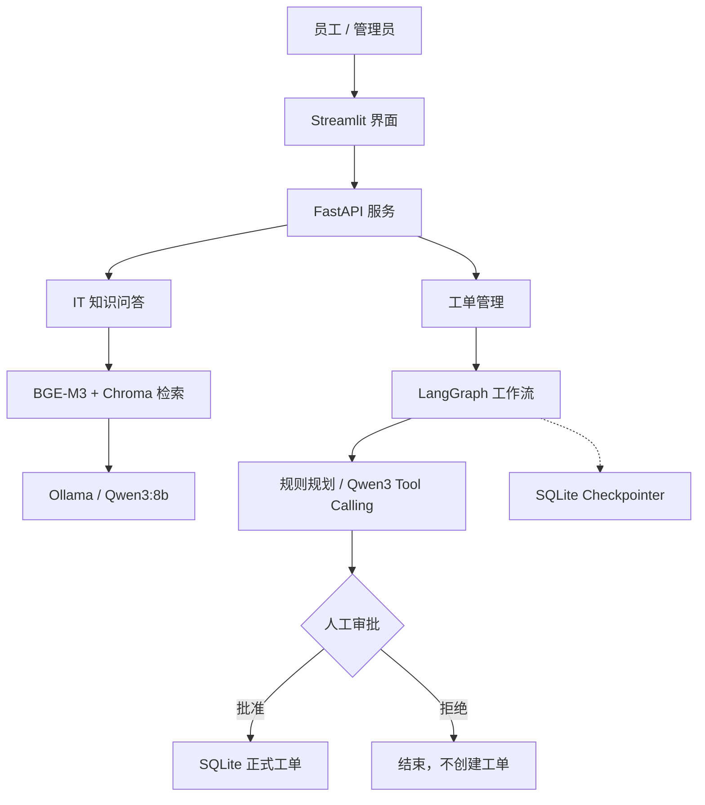

# OpsDesk Agent

**Local Enterprise IT Service Agent · RAG · Tool Calling · Human-in-the-loop**

OpsDesk Agent 是一个面向企业 IT 服务场景的本地 AI Agent 项目，围绕“**知识问答 → 故障描述 → 工单规划 → 人工审批 → 工单持久化**”构建完整的业务闭环。

系统使用 **Ollama + Qwen3:8b** 在本地完成回答生成与结构化工单规划，基于 **BGE-M3 + Chroma** 检索 IT 知识文档，并通过 **LangGraph** 管理需要人工审批的工单流程。**FastAPI** 提供服务接口，**Streamlit** 提供交互界面。

> **项目状态：本地可运行的 MVP。** 已实现知识问答、工单提交与审批、SQLite 工单存储、工作流检查点恢复及基础接口认证。当前使用示例 IT 知识与本地部署方式，不代表已接入真实企业系统。

## 核心能力

| 能力 | 实现方式 | 业务价值 |
| --- | --- | --- |
| IT 知识问答 | BGE-M3、Chroma、Qwen3 | 检索知识文档，结合检索结果生成回答并展示来源 |
| 结构化工单规划 | 规则规划 / Qwen3 Tool Calling | 将自然语言故障描述转为可校验的工单草稿 |
| 人工审批 | LangGraph、Human-in-the-loop | 在正式写入工单前保留人工决策环节 |
| 工作流恢复 | SQLite Checkpointer | 保存待审批状态，支持中断后的继续处理 |
| 工单持久化与幂等 | SQLite、`request_id` | 保存正式工单，防止重复创建 |
| 服务与界面 | FastAPI、Streamlit | 提供知识问答、工单提交、审批和查询入口 |
| 基础访问控制 | 员工 / 管理员 API Key | 区分工单申请和管理操作的调用权限 |

## 系统架构



架构分成两条相互独立的业务路径：

- **知识问答路径：** 接收 IT 问题 → 检索相关知识片段 → 使用本地模型组织回答 → 返回答案与来源。
- **工单路径：** 接收故障描述 → 生成结构化草稿 → 业务校验 → 进入待审批状态 → 管理员批准或拒绝 → 批准后写入正式工单。

模型负责理解和生成，**审批、权限检查、持久化与幂等约束由后端执行**，不能仅依赖模型输出保证业务安全。

## 关键设计

### 1. RAG 知识问答

系统使用 BGE-M3 对 IT 知识内容进行向量化，利用 Chroma 检索与问题相关的文档片段，再由 Qwen3 结合检索上下文生成回答。

例如，用户可以询问：

> VPN 连接失败并提示身份验证错误，应该如何排查？

回答中保留知识来源标识，便于追溯检索材料。引用来源不等同于自动事实核验；对于知识库未覆盖的企业政策或操作流程，系统不应给出未经证实的承诺。

### 2. Tool Calling 与工单规划

员工提交自然语言故障描述后，系统将其转换为结构化工单草稿。项目支持两种规划方式：

| 模式 | 说明 |
| --- | --- |
| `rule` | 使用确定性规则形成工单草稿，便于稳定测试 |
| `llm` | 由本地 Qwen3 通过 Tool Calling 生成结构化参数 |

模型生成的参数仍需经过后端校验。**生成工单草稿不等于直接创建正式工单。**

### 3. LangGraph 人工审批

工单申请进入 `pending_approval` 状态后，管理员可以查询工作流及工单草稿，选择批准或拒绝。

批准后，系统按业务规则写入 SQLite；拒绝后结束流程，不创建正式工单。重复审批与不符合当前状态的操作由后端拒绝，避免对同一申请重复执行。

### 4. 检查点恢复与幂等

项目分别处理两种不同的持久化需求：

- **工作流状态：** 由 SQLite Checkpointer 保存 LangGraph 的中间执行状态，支持等待审批期间的中断与后续恢复。
- **正式业务数据：** 由 SQLite 保存已创建的工单，并使用 `request_id` 作为业务幂等标识，减少重复提交或重复执行造成的重复创建。

工作流检查点与正式工单记录承担不同职责，不能互相替代。

### 5. API 访问控制

项目通过服务端配置的员工 API Key 和管理员 API Key 区分申请与审批操作。该机制适用于本地 MVP 的接口权限隔离，**不等价于真实用户身份管理、RBAC 或完整审计体系**。

## 技术栈

| 技术 | 用途 |
| --- | --- |
| Python | 核心开发语言 |
| LangGraph | 状态化工作流、人工审批与恢复 |
| LangChain / ChatOllama | 本地模型集成 |
| Ollama + Qwen3:8b | 回答生成与结构化工单规划 |
| BGE-M3 | 文本向量化 |
| Chroma | 知识片段向量存储与检索 |
| SQLite | 正式工单与工作流检查点存储 |
| FastAPI | HTTP API |
| Streamlit | Web 交互界面 |

## 本地运行

### 环境要求

- Windows 与 Python 环境
- 已安装并运行 Ollama
- 本地可用的 `qwen3:8b` 与 `bge-m3` 模型
- 可安装项目 `requirements.txt` 中列出的依赖

### 安装与配置

在 PowerShell 中执行：

```powershell
git clone https://github.com/yanzz66/opsdesk-agent.git
cd opsdesk-agent

python -m venv .venv
.\.venv\Scripts\python.exe -m pip install -r requirements.txt

Copy-Item .env.example .env
```

然后修改本地 `.env`，配置模型服务、数据库路径和员工 / 管理员 API Key。主要配置项包括：

```dotenv
OLLAMA_BASE_URL=http://127.0.0.1:11434
OLLAMA_CHAT_MODEL=qwen3:8b
OLLAMA_EMBED_MODEL=bge-m3

OPSDESK_USER_KEY=replace_with_your_own_key
OPSDESK_APPROVER_KEY=replace_with_another_key

OPSDESK_CHECKPOINT_BACKEND=sqlite
OPSDESK_TICKET_PLANNER=rule
```

实际数据库路径及其他参数请以仓库中的 `.env.example` 为准。首次进行知识问答前，需要确保本地知识库向量索引已经建立。**不要将真实 `.env` 或密钥提交到 Git。**

### 启动服务

在已完成环境配置的 Windows 机器上运行：

```powershell
.\start-opsdesk.cmd
```

该脚本用于检查并启动本地服务。若迁移到其他电脑，可能需要根据实际 Ollama 安装路径调整启动配置。

| 服务 | 默认地址 |
| --- | --- |
| Ollama | `http://127.0.0.1:11434` |
| FastAPI | `http://127.0.0.1:8000` |
| Swagger API 文档 | `http://127.0.0.1:8000/docs` |
| Streamlit | `http://127.0.0.1:8501` |

## 主要 API

| 方法 | 路径 | 作用 |
| --- | --- | --- |
| `GET` | `/health` | 服务健康检查 |
| `POST` | `/api/knowledge/ask` | RAG 知识问答 |
| `POST` | `/api/tickets` | 提交待审批工单 |
| `GET` | `/api/tickets/workflows/{thread_id}` | 查询工单工作流状态 |
| `POST` | `/api/tickets/workflows/{thread_id}/decision` | 批准或拒绝工单 |
| `GET` | `/api/tickets/{ticket_id}` | 查询正式工单 |

接口请求字段、认证方式和响应结构以本地 Swagger 文档为准。

## 测试与验证

项目开发过程中已针对工单存储、审批、检查点恢复、接口认证及本地模型端到端链路进行测试。以下为现有测试脚本的代表性运行方式：

```powershell
.\.venv\Scripts\python.exe -m scripts.test_ticket_store
.\.venv\Scripts\python.exe -m scripts.test_checkpoint_restart
.\.venv\Scripts\python.exe -m scripts.test_api_tickets
.\.venv\Scripts\python.exe -m scripts.test_api_live_e2e
```

其中，真实模型端到端测试要求 Ollama、Qwen3 及相关服务正常运行。测试的具体通过情况应以当前代码版本的实际执行结果为准。

核心验证场景包括：工单提交、待审批状态查询、批准与拒绝、拒绝后不落库、重复审批保护、SQLite 工单查询，以及工作流中断后的恢复。

## 当前范围与限制

本项目当前定位为**本地企业 IT 服务流程 MVP**，尚未覆盖真实企业级部署所需的全部能力：

- 认证依赖配置式 API Key，尚未接入真实员工账号、角色权限体系或完整审计日志。
- 知识问答提供来源信息，但没有对所有自然语言结论进行自动事实核验。
- 前端聊天历史依赖 Streamlit 会话状态，不保证跨浏览器会话持久保存。
- 尚未提供面向多用户并发、分布式任务调度与完整可观测性的生产级方案。
- 演示知识文档与工单流程用于展示系统能力，不代表真实企业 IT 制度。

## 项目说明

OpsDesk Agent 将**检索增强生成（RAG）**与**受控业务执行（Tool Calling + LangGraph）**结合起来：知识问答负责提供有来源的参考信息，工单工作流负责把自然语言申请转换为可审批、可恢复、可持久化的业务操作。两个流程共用本地模型服务，但分别承担信息查询与有状态业务处理的职责。
